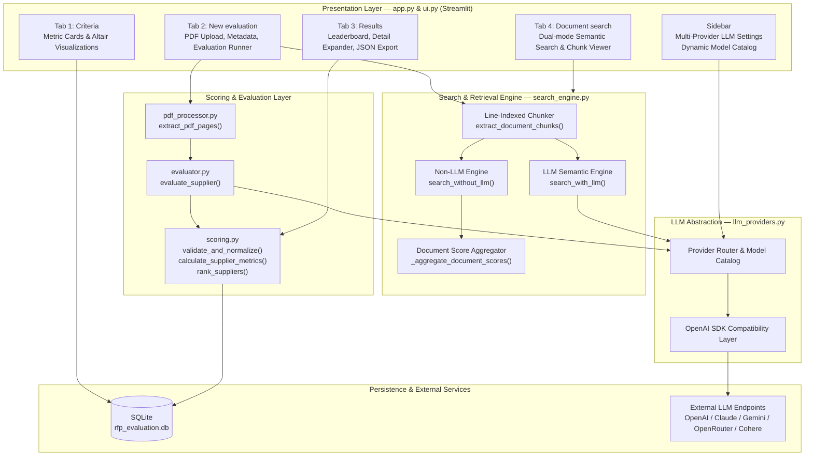
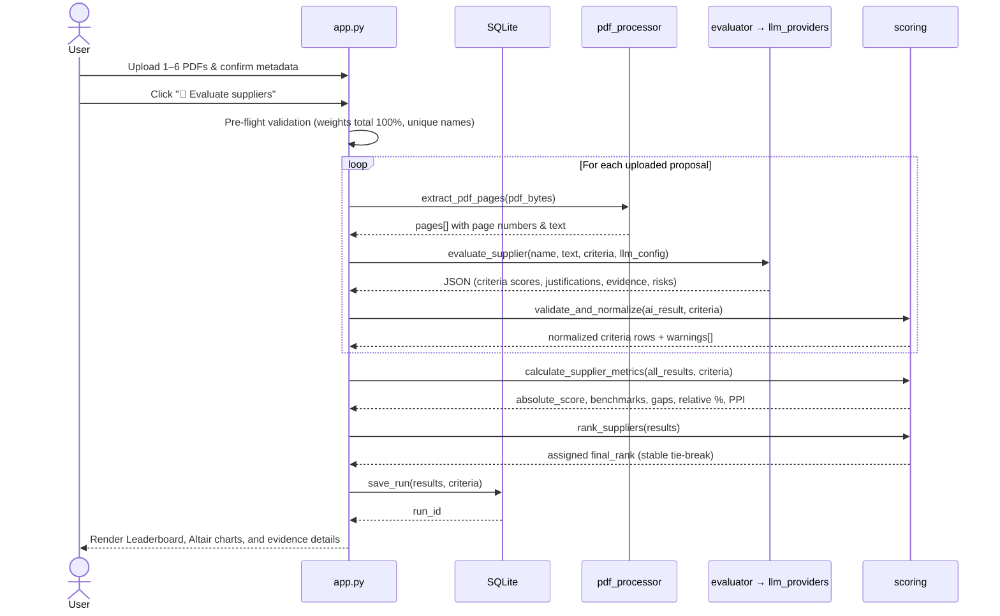
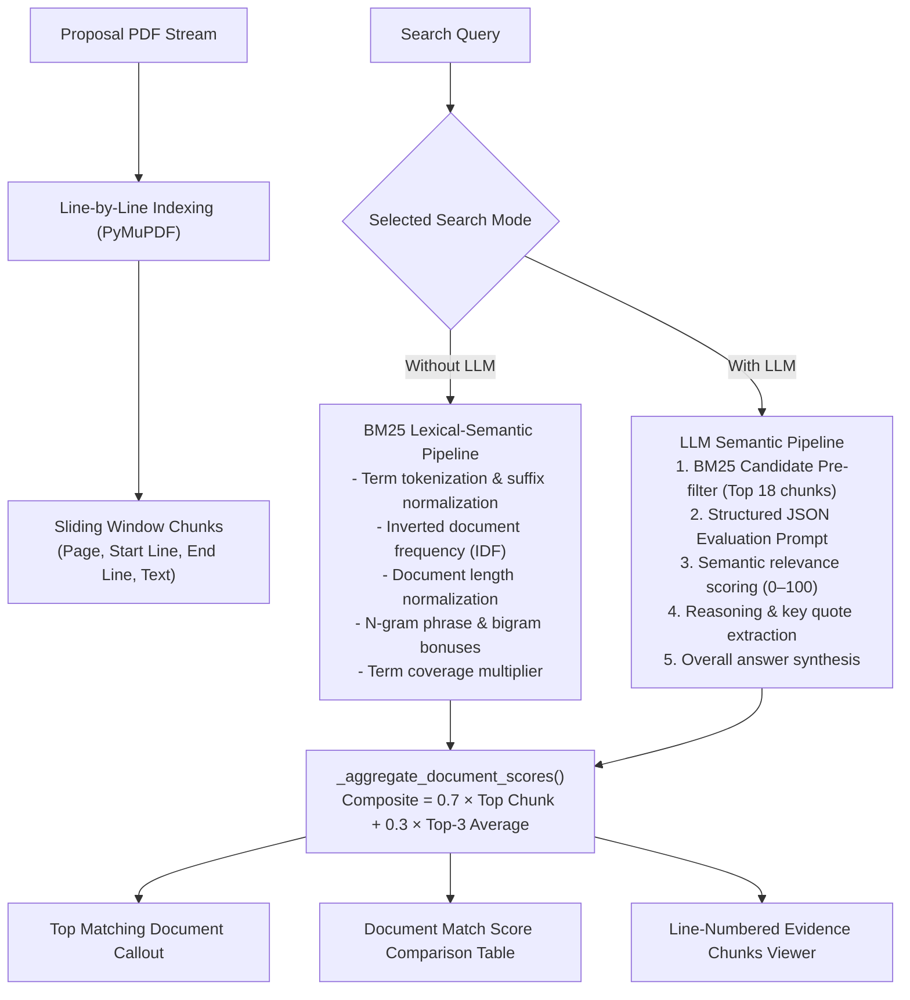
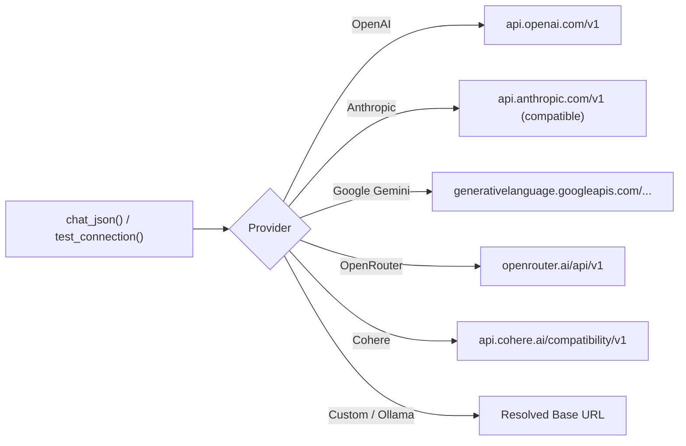

# Agentic RFP Evaluation — Technical Documentation

This document explains how the application is architected, how data flows through each module, and how each subsystem is implemented. It covers `app.py`, `ui.py`, `pdf_processor.py`, `search_engine.py`, `evaluator.py`, `llm_providers.py`, `scoring.py`, and `database.py`.

---

## 1. System Architecture & Separation of Concerns

The application follows a strict separation of responsibilities between natural-language judgment, deterministic computation, persistence, and information retrieval:

| Layer | Module(s) | Owns | Does **NOT** own |
|---|---|---|---|
| **Presentation & UI** | `app.py`, `ui.py` | Streamlit layout, session state, React-Aria tabs, Altair chart styling, chunk evidence viewer | Scoring logic or database writes directly |
| **Information Retrieval** | `search_engine.py` | Line-indexed chunking, BM25 retrieval, LLM semantic re-ranking, document-level match aggregation | File persistence or global state |
| **Model Access** | `llm_providers.py`, `evaluator.py` | Multi-vendor LLM routing (OpenAI, Anthropic, Gemini, OpenRouter, Cohere), prompt assembly, JSON extraction | Arithmetic, weighting, benchmarking, or ranking |
| **Deterministic Scoring** | `scoring.py` | Score normalization, boundary clipping, peer benchmarks, criterion gaps, PPI, total tie-break ranking | Subjective document evaluation |
| **Document Processing** | `pdf_processor.py` | PyMuPDF in-memory text & page extraction | Chunk scoring or text truncation |
| **Persistence** | `database.py` | SQLite connection pooling, criteria seeding, run history snapshots | Evaluation logic |

This hard boundary ensures that all mathematical outcomes and ranking decisions are 100% deterministic, reproducible, and verifiable.

---

## 2. Component Map



---

## 3. End-to-End Processing Flows

### 3.1 Proposal Evaluation Pipeline



---

## 4. Semantic Document Search Engine (`search_engine.py`)

The search engine allows procurement evaluators to query proposal content across all uploaded PDFs using either an instantaneous statistical algorithm (Without LLM) or an intelligent semantic reasoning model (With LLM).



### 4.1 Chunk Extraction with Line & Page Tracking
Text is extracted page-by-page using PyMuPDF. Non-empty lines are indexed with their 1-based page line number. A sliding window of 5 lines with a step of 3 lines generates overlapping chunks that preserve syntactic context across sentence boundaries:

$$\text{Chunk} = \left\{\text{chunk\_id}, \text{document\_name}, \text{page}, \text{start\_line}, \text{end\_line}, \text{text}, \text{lines}: [(l_i, \text{text}_i)]\right\}$$

### 4.2 Non-LLM Retrieval (BM25 Semantic Ranking)
The non-LLM engine computes relevance using the Okapi BM25 formulation augmented with phrase-matching and query-coverage heuristics:

$$\text{IDF}(q) = \ln\left(1 + \frac{N - n(q) + 0.5}{n(q) + 0.5}\right)$$

$$\text{Score}_{\text{BM25}}(D, Q) = \sum_{q \in Q} \text{IDF}(q) \cdot \frac{f(q, D) \cdot (k_1 + 1)}{f(q, D) + k_1 \cdot \left(1 - b + b \cdot \frac{|D|}{\text{avgdl}}\right)}$$

Where:
- $k_1 = 1.5$ (term frequency saturation parameter)
- $b = 0.75$ (document length normalization factor)
- Exact phrase bonus: $+4.5$ if query appears verbatim
- Bigram bonus: $+1.8$ per matching word pair
- Coverage factor: $(0.6 + 0.4 \times \frac{|\text{matched query terms}|}{|\text{total query terms}|})$

### 4.3 LLM-Powered Semantic Retrieval
When LLM mode is enabled:
1. Fast candidate retrieval selects the top 15–18 candidate chunks across all documents.
2. The candidates are packaged into a structured schema prompt sent to `chat_json()`.
3. The model assesses semantic intent, synonyms (e.g. mapping "SLA commitments" to "1-hour critical response"), and implicit compliance.
4. The model returns:
   - `relevance_score` (0–100) per chunk
   - `reasoning` (concise 1-sentence justification)
   - `matched_quote` (exact phrase cited from the chunk)
   - `most_relevant_document`
   - `overall_answer` (synthesis of proposal findings)

### 4.4 Document-Level Aggregation
To determine which document matches the search query most effectively:

$$\text{Composite Score} = 0.7 \times \max(\text{scores}_d) + 0.3 \times \text{mean}(\text{top\_3\_scores}_d)$$

This ensures that a document containing multiple strong matching clauses ranks higher than one with a single isolated keyword hit.

---

## 5. Scoring Mathematics & Deterministic Ranking

Scoring calculations in `scoring.py` are pure functions executed in Python:

### 5.1 Absolute Weighted Score
$$\text{Absolute Score} = \frac{1}{10} \sum_{i} \left(\frac{\text{score}_i}{\text{max\_score}_i} \times \text{weight}_i\right) \quad \in [0, 10]$$

### 5.2 Peer Benchmarking & Gap
$$\text{Benchmark}_i = \max_{s \in \text{Specified}}(\text{score}_{i, s})$$
$$\text{Gap}_{i, s} = \text{score}_{i, s} - \text{Benchmark}_i \quad (\le 0)$$

### 5.3 Relative Performance & Peer Performance Index (PPI)
$$\text{Relative Performance}_{i, s} = \begin{cases} 
\left(\frac{\text{score}_{i, s}}{\text{Benchmark}_i}\right) \times 100 & \text{if } \text{Benchmark}_i > 0 \\
100 & \text{if } \text{Benchmark}_i = 0 \text{ and status is specified} \\
0 & \text{otherwise}
\end{cases}$$

$$\text{PPI}_s = \frac{\sum_i (\text{Relative Performance}_{i, s} \times \text{weight}_i)}{\sum_i \text{weight}_i} \quad \in [0, 100]$$

### 5.4 Stable Tie-Break Ranking Order
The ranking sort tuple guarantees a total, deterministic ordering:
1. $\text{PPI} \downarrow$ (higher is better)
2. $\text{Submission Date} \uparrow$ (earlier submission wins)
3. $\text{Experience Rating} \downarrow$ (higher historical rating wins)
4. $\text{Supplier Name (A–Z)}$ (case-folded alphabetical fallback)

---

## 6. Multi-Provider LLM Architecture (`llm_providers.py`)

All supported providers route through a unified OpenAI-compatible SDK client abstraction:



- **Dynamic Catalog Discovery:** `fetch_models()` queries the provider's `/models` endpoint to display only models accessible to the current API key.
- **JSON Mode with Fallback:** Configures `response_format={"type": "json_object"}` where supported, and falls back to regex-tolerant JSON fence extraction (`_extract_json`) for providers that reject response format headers.

---

## 7. Visual Design System & UI Specifications (`ui.py`)

### 7.1 Modern Tab Component Styling
Streamlit modern releases use React-Aria tab specifications. CSS selectors target:
- `.stTabs [role="tablist"]`, `[data-testid="stTabs"] [role="tablist"]`: Pill container with `#FFFFFF` background, `14px` border-radius, and subtle drop shadow.
- `.stTabs [data-testid="stTab"]`, `.stTabs [role="tab"]`: `42px` height, `0 20px` horizontal padding, `11px` border-radius, and smooth hover transition.
- Active tab: Gradient background `linear-gradient(135deg, #4F46E5, #06B6D4)` with `#FFFFFF` text.
- Hidden selection underline: `.react-aria-SelectionIndicator` and `[role="tablist"]::after` are suppressed (`display: none !important`).

### 7.2 Sidebar Dark Mode Theme Rules
The sidebar uses a deep navy gradient (`#221F57` to `#0E7490`). High-contrast overrides include:
- **Buttons (`↻ Models`, `✓ Test`):** `#FFFFFF` background with `#1E2235` bold text and `#EEF2FF` hover state.
- **Status Pills (`rfp-pill`):** Scoped `!important` text colors preserving warning amber (`#9A5B00` on `#FFF3E0`) and success green (`#0A7A52` on `#E7F8F0`).
- **Hyperlinks:** Bright cyan (`#38BDF8 !important; text-decoration: underline;`).
- **Tooltip Icons:** Periwinkle stroke (`#A5B4FC !important;`).

### 7.3 Altair Chart Geometry
- **Donut & Pie Charts (`_arc_chart`):** `outerRadius=86`, `innerRadius=50` (or `0` for pie), `height=320`, with `padding={"top": 12, "bottom": 12}` and `alt.TitleParams` to prevent canvas clipping and legend collisions.
- **Horizontal Bar Chart (`hbar_chart`):** `mark_bar(cornerRadiusEnd=6, height=20)`, `scale=alt.Scale(paddingInner=0.35)`, `height=max(180, 42 * len(df))`, and `axis=alt.Axis(format=".0f", tickMinStep=1, labelLimit=300)` for integer-stepped axes without label truncation.

### 7.4 Line-Numbered Chunk Evidence Viewer
`ui.chunk_card()` renders retrieved chunks with:
- Document badge, page number, and line range header.
- Match percentage indicator with conditional color thresholds (green $\ge 75\%$, amber $\ge 45\%$, gray $< 45\%$).
- LLM semantic reasoning callout and key quote citation.
- Dark terminal box (`#0F172A`) with aligned line numbers (`L14 |`, `L15 |`) and keyword highlight marks.

---

## 8. Data Schema & Persistence (`database.py`)

SQLite database (`rfp_evaluation.db`) uses real columns for queryable ranking metrics and structured JSON snapshots for full auditable criteria details:

```mermaid
erDiagram
    evaluation_criteria {
        INTEGER criterion_id PK
        TEXT name
        TEXT description
        REAL weight
        REAL max_score "default 10"
        INTEGER is_active "default 1"
    }
    rfp_runs {
        TEXT rfp_run_id PK "RFP-<10 hex>"
        TEXT created_at "UTC ISO-8601"
        TEXT status "completed"
    }
    supplier_results {
        INTEGER result_id PK AUTOINCREMENT
        TEXT rfp_run_id FK
        TEXT supplier_name
        TEXT source_filename
        TEXT submission_date
        REAL experience_rating
        REAL absolute_score
        REAL ppi
        INTEGER final_rank
        TEXT result_json "full snapshot"
    }
    rfp_runs ||--o{ supplier_results : contains
```

---

## 9. Technology Stack

| Dependency | Minimum Version | Functional Purpose |
|---|---|---|
| `streamlit` | `1.40.0` | Reactive web application framework, state management, file uploader |
| `altair` | `5.4.0` | Declarative statistical charting (donut, pie, integer horizontal bar) |
| `pymupdf` | `1.24.0` | High-speed PDF text extraction and per-page line extraction |
| `pandas` | `2.2.0` | Tabular data manipulation and Streamlit progress column formatting |
| `numpy` | `1.26.0` | Vector operations, array manipulations, and search score calculations |
| `openai` | `1.50.0` | Client SDK connecting to OpenAI, Anthropic, Gemini, OpenRouter, and Cohere |
| `python-dotenv`| `1.0.0` | Local environment configuration and credential loading |
| `reportlab` | `4.0.0` | Synthetic benchmark PDF generation (`sample_pdfs/`) |
| `sqlite3` | stdlib | Local relational database for criteria configuration and run persistence |

---

## 10. Automated Test Suites

The codebase includes comprehensive automated tests covering calculations, tie-breaks, and search retrieval:

1. **`test_scoring.py`**:
   - `test_validation_and_normalization`: Verifies score clipping, missing criteria defaults, and malformed JSON handling.
   - `test_metrics_and_ranking`: Verifies absolute score calculations, benchmarks, gaps, PPI weighted averages, and tie-break ordering.

2. **`test_search_engine.py`**:
   - `test_chunking_metadata`: Confirms 1-based page and line number indexing across PDF pages.
   - `test_search_without_llm_technical_query`: Validates that architectural and disaster recovery queries rank *Apex Systems* #1 with $>80\%$ score.
   - `test_search_without_llm_pricing_query`: Validates exact pricing retrieval and line citation.
   - `test_search_empty_query`: Verifies defensive handling of empty query strings.
   - `test_document_rankings_included`: Validates aggregate document scoring.
